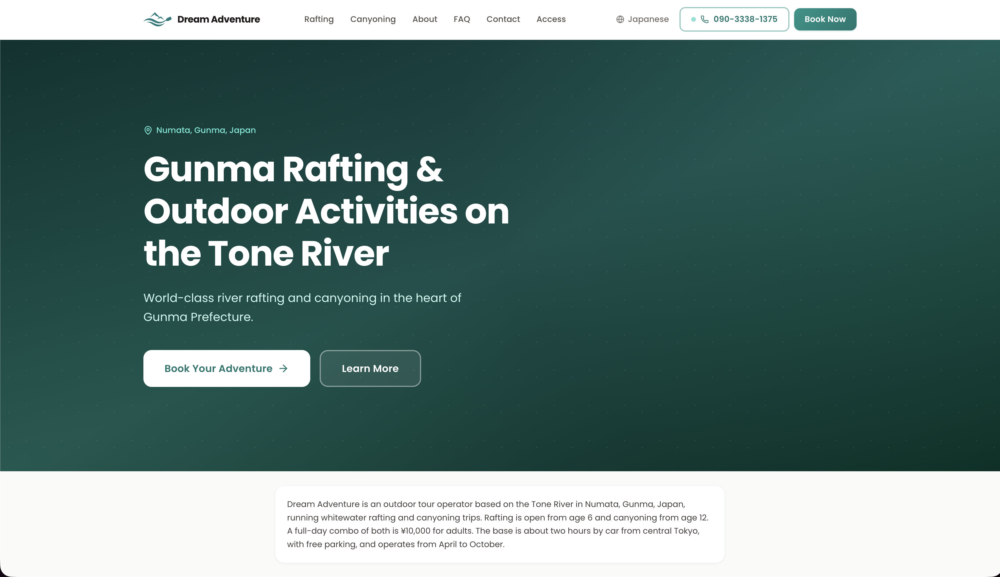
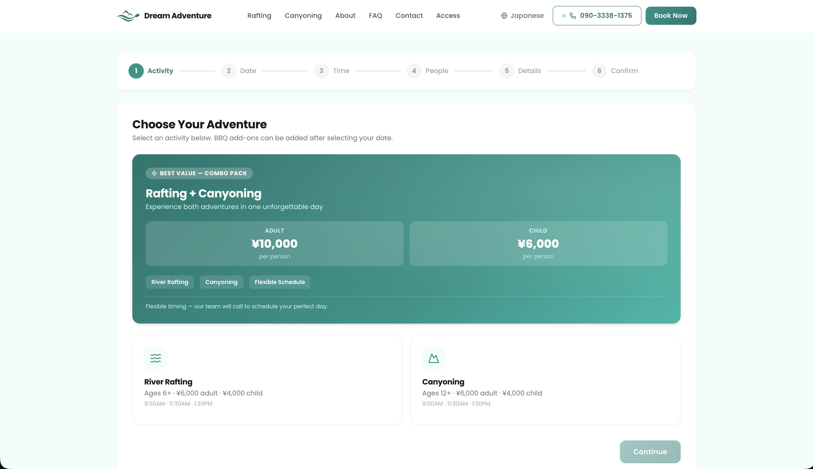
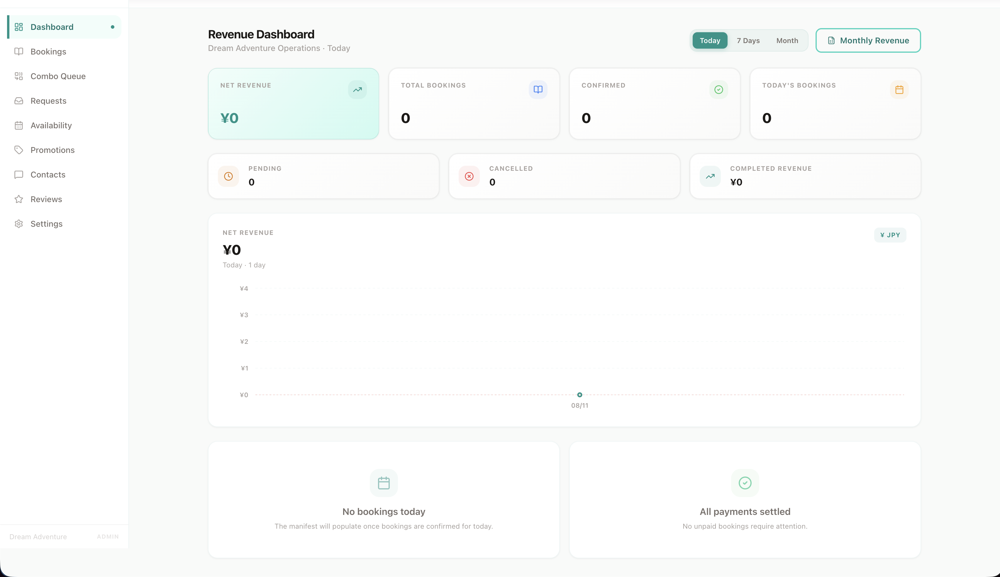
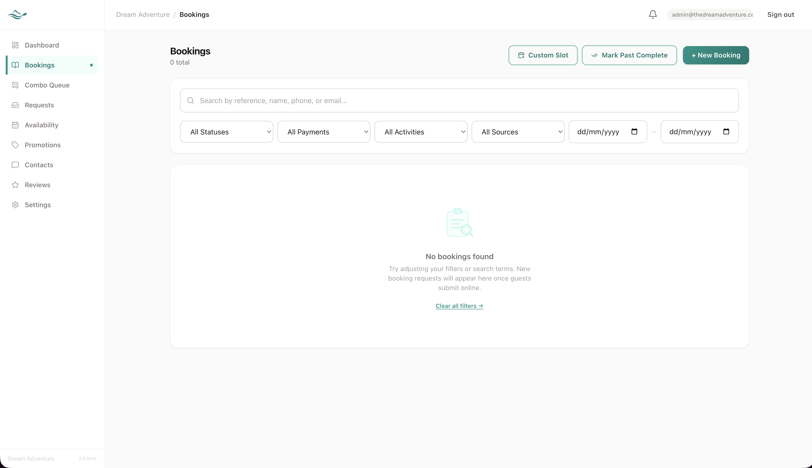

# Dream Adventure Gunma — Booking Platform

A production booking and operations platform for an adventure-tourism operator in Gunma, Japan — bilingual JP/EN, offline payment collection with admin-side payment tracking, and a full admin console.

[](https://nextjs.org)
[](https://www.typescriptlang.org)
[](https://www.prisma.io)
[](./LICENSE)

---

## Overview

Dream Adventure Gunma operates rafting and canyoning tours on the Tone River in Numata, Gunma Prefecture, Japan. This codebase is the entirety of their customer-facing website and internal operations system — not a prototype or demo. It handles real bookings, collects contact details for real guests, and supports the staff who run tours every day.

The public site is bilingual: Japanese at the root path (`/`) and English at `/en`. Japanese is the primary locale because the operator's core guest base is domestic. Guests can browse tour pages, read the blog, submit a booking request, manage their existing booking (including cancellation and reschedule requests), and download a receipt PDF. All of this works from mobile.

The admin console (`/admin`) is a separate, auth-protected section of the same Next.js application. It is English-only and gives the operator a single interface to confirm bookings, track payments, manage availability slots, issue refunds, export revenue data, and receive real-time notifications via email, LINE, and WhatsApp when a guest submits a new booking.

---

## Screenshots


*Homepage hero and activity cards showcasing Tone River rafting and canyoning tours.*


*Multi-step booking wizard with dynamic date/slot selection and participant age validation.*


*Admin operations dashboard featuring real-time revenue analytics, KPIs, and booking summaries.*


*Admin booking manifest table displaying daily tour schedules, slot capacity, and participant details.*

---

## Features

### Public Site

| Area | Details |
|---|---|
| **Homepage** | Hero, activity cards for Rafting / Canyoning / Combo, FAQ section, access/map panel, structured JSON-LD for local business SEO |
| **Activity pages** | Dedicated `/rafting` and `/canyoning` pages with season, safety, and pricing information |
| **Multi-step booking** | Wizard at `/booking` — activity/date selection, participant details, age validation (rafting children ≥ 6; canyoning children ≥ 12), promo code application, review and submit |
| **Booking confirmation** | `/booking/confirmation` — locale-aware, displays the booking reference |
| **Booking cancellation page** | `/booking/cancelled` — shown when a guest backs out; no automatic DB cancellation |
| **Guest management portal** | `/manage/[reference]` — two-factor ownership check (reference + email). Guests can view booking details, download their receipt PDF, submit a cancellation request, or request a reschedule |
| **Blog** | Six static posts under `/blog/*` covering rafting and canyoning in Gunma; dynamic catch-all slug route for future posts |
| **FAQ** | Interactive accordion at `/faq` |
| **Contact** | Form at `/contact` that writes a `ContactSubmission` record and triggers email notification |
| **Access** | `/access` — directions, embedded Google Map, transit information |
| **Legal** | `/privacy` and `/terms` |
| **i18n** | All routes above are available at root (`ja`) and `/en`. Translation files in `messages/ja.json` and `messages/en.json` |

### Admin Console (`/admin`)

| Panel | Details |
|---|---|
| **Dashboard** | Today's booking summary, revenue KPIs, recharts revenue chart, quick-action links |
| **Bookings list** | Filterable list of all bookings; status and payment badges; link to booking detail |
| **Booking detail** | View all participant data, change status/payment status, add internal notes, trigger PDF generation (receipt + waiver), export booking data |
| **New manual booking** | `/admin/bookings/new` — create a booking on behalf of a guest (bypasses the 48-hour cutoff) |
| **Combo queue** | `/admin/combos` — bookings flagged as combo packages awaiting slot assignment |
| **Availability** | `/admin/availability` — create and manage `AvailabilitySlot` records (date, time, capacity); block slots; update slot conditions |
| **Promotions** | `/admin/promotions` — create/deactivate percentage or fixed-amount promo codes |
| **Change requests** | `/admin/requests` — review guest cancellation and reschedule requests submitted via the management portal |
| **Contact submissions** | `/admin/contacts` — inbox for contact form submissions; mark as replied |
| **Reviews** | `/admin/reviews` — manage testimonials shown on the public site |
| **Settings** | `/admin/settings` — system-level toggles including maintenance mode |
| **CSV exports** | `GET /api/admin/export/bookings` (all bookings) and `GET /api/admin/export/revenue` (monthly payment ledger) |
| **PDF generation** | `GET /api/admin/bookings/[id]/generate-pdfs` — receipt and waiver PDF via `@react-pdf/renderer`, uploaded to Supabase Storage |

---

## Architecture

### Request Path

A public booking request follows this path:

1. **Browser → Next.js App Router**: The booking wizard runs as a Client Component under `src/components/booking/steps/`. It calls `POST /api/booking/create` on submit.
2. **Route Handler** (`src/app/api/booking/create/route.ts`): Validates the payload with Zod, checks the 48-hour cutoff (comparing the slot's departure time to the current JST clock), verifies capacity, then calls `createBooking()` in `src/lib/services/booking.ts`.
3. **Prisma service layer**: `createBooking()` writes a `Booking` record with status `PENDING`, writes `BookingParticipant` rows, decrements available capacity on the `AvailabilitySlot`, and writes an `AuditLog` entry — all in a single Prisma transaction.
4. **Notification fan-out**: After the transaction commits, `triggerPendingBookingNotifications()` sends a transactional email to the guest via Resend, and pushes LINE and WhatsApp messages to the operator — all fire-and-forget so a channel failure does not roll back the booking.
5. **Admin confirmation**: The operator opens `/admin/bookings`, reviews the booking, and marks it `CONFIRMED`. That status change triggers another notification to the guest.
6. **Payment**: Collected offline — cash, card terminal on-site, or bank transfer. The admin records payment in the booking detail page; the `BookingPayment` ledger tracks each transaction individually.

### Data Model

Core Prisma models (PostgreSQL via Supabase):

| Model | Purpose |
|---|---|
| `Booking` | One row per booking; holds status, payment status, source, lead guest details |
| `BookingParticipant` | One row per participant; stores age, type (ADULT/CHILD), and signed waiver data |
| `BookingPayment` | Ledger of individual payment transactions (supports partial refunds) |
| `AvailabilitySlot` | An operator-defined slot (date + time + capacity + condition); the inventory unit |
| `Promotion` | Promo codes (PERCENT or FIXED discount) with usage tracking |
| `BookingRequest` | Guest-submitted cancellation or reschedule request awaiting admin review |
| `AuditLog` | Immutable append-only log of every admin mutation; stores before/after JSON |
| `ContactSubmission` | Contact form submissions |
| `AdminUser` | Admin accounts with bcrypt-hashed passwords |
| `SystemSetting` | Key-value store for admin-toggleable flags (e.g., `maintenanceMode`) |
| `NotificationLog` | Record of every notification send attempt (channel, status, bookingId) |

### i18n Routing

`next-intl` v4.9.1 with `localePrefix: "as-needed"`:

- Japanese is the default locale and is served at `/` with no prefix.
- English is served at `/en/*`.
- `/ja` and `/ja/*` are 301-redirected to their unprefixed equivalents via `next.config.ts`.
- `localeDetection: false` — the site does not auto-detect browser language.

### Kill Switches

Two environment variables act as independent fail-closed guards:

**`NEXT_PUBLIC_GRAND_OPENING_SOON`** (read in `src/app/[locale]/layout.tsx` at server render time):

- Controls whether the public site is visible to visitors.
- Any value other than the string `"false"` activates the `ConstructionBlockade` component — including an unset or empty variable.
- Set to `"false"` in Vercel to serve the live site.

**`GRAND_OPENING_SOON`** (read in `src/lib/maintenance.ts`):

- Server-side API-layer gate: controls whether `POST /api/booking/create` accepts new bookings.
- Any value other than `"false"` blocks booking creation.
- Independent of the first variable — allows the UI to be visible while the booking API is still gated, or vice-versa.

The `/admin` panel is not affected by either variable.

---

## Engineering Decisions

**Kill switches fail closed, not open.** Both `NEXT_PUBLIC_GRAND_OPENING_SOON` and `GRAND_OPENING_SOON` default to blocking if the environment variable is absent, empty, or any value other than the exact string `"false"`. A misconfigured deploy or a missing variable therefore hides the site rather than accidentally exposing it. This is the only safe default for a business that controls when its product goes live.

**Business constants live in `src/lib/utils.ts`, not the database.** Pricing (¥6,000 adult / ¥4,000 child for rafting and canyoning; ¥10,000 adult / ¥6,000 child for the combo) and the 48-hour booking cutoff are hardcoded. A database-driven pricing table would add a round-trip query to every booking flow, introduce a failure mode (what if the DB row is deleted?), and make it harder to audit what the system charged at any point in history. When prices change, they change in one file, in one diff, with a clear commit message.

**Bookings and guides are soft-deleted.** `cancelBooking()` sets `status = CANCELLED`; there is no `prisma.booking.delete()` anywhere in the codebase. Guides are deactivated by setting `isActive = false`. This preserves the audit trail for a business that handles money. A cancelled booking still has an associated `AuditLog`, can be referenced in payment disputes, and appears correctly in historical revenue exports.

**Every timestamp is computed in JST.** Japan Standard Time is UTC+9 with no daylight-saving transitions. The server (Vercel) runs in UTC. Wherever a "today" boundary matters — booking cutoff checks, slot availability queries, the cron job that runs post-trip notifications — the code adds `9 * 60 * 60 * 1000` ms to `Date.now()` before extracting date components. Using `new Date()` directly would cut off slots at 3pm JST (midnight UTC) when guests can still legitimately book same-day tours.

**Server actions return `{ success: true } | { error: string }`, never throwing.** Every mutation in `src/app/actions/` catches all errors at the boundary and returns a typed discriminated union. The client receives a predictable shape it can branch on. Raw exceptions never cross the server/client boundary, which means stack traces and internal error messages are not serialized into the HTTP response. Known error codes from the service layer (e.g., `REQUEST_ALREADY_EXISTS`) are translated to user-readable messages at the action boundary; unknown errors fall back to a generic string.

**Notification delivery is fire-and-forget.** `triggerPendingBookingNotifications()` calls Resend, LINE, and WhatsApp in parallel using `Promise.allSettled`. A failed email or LINE push does not roll back the booking transaction or surface an error to the guest. Each attempt is logged to `NotificationLog` regardless of outcome, giving the operator a record of delivery failures to investigate manually.

---

## Getting Started

### Prerequisites

- Node.js ≥ 20
- A Supabase project (PostgreSQL database + Storage bucket)
- A Resend account (transactional email)

### Installation

```bash
# 1. Clone the repo
git clone https://github.com/zetroxyyy/rafting-canyoning-site.git
cd rafting-canyoning-site

# 2. Install dependencies
npm ci

# 3. Copy the environment template and fill in your values
cp .env.example .env.local

# 4. Generate the Prisma client
npx prisma generate

# 5. Push the schema to your Supabase database
npx prisma db push

# 6. Start the dev server
npm run dev
```

The app will be available at `http://localhost:3000`.

> **Note on the blockade:** By default, `NEXT_PUBLIC_GRAND_OPENING_SOON` is unset, so `localhost:3000` shows the `ConstructionBlockade` holding page. Add `NEXT_PUBLIC_GRAND_OPENING_SOON=false` to your `.env.local` to see the full site locally.

---

## Environment Variables

See [`.env.example`](./.env.example) for the complete list with comments. Required variables by group:

| Group | Variables |
|---|---|
| **Database** | `DATABASE_URL`, `DIRECT_URL` |
| **Supabase Storage** | `NEXT_PUBLIC_SUPABASE_URL`, `SUPABASE_SERVICE_ROLE_KEY` |
| **Auth** | `AUTH_SECRET`, `ADMIN_PASSWORD` |
| **Email** | `RESEND_API_KEY` |
| **LINE notifications** | `LINE_CHANNEL_ACCESS_TOKEN`, `LINE_ADMIN_USER_ID` |
| **WhatsApp notifications** | `WHATSAPP_API_KEY`, `WHATSAPP_PHONE_NUMBER_ID`, `WHATSAPP_ADMIN_PHONE` |
| **Google Places** | `GOOGLE_PLACES_API_KEY`, `GOOGLE_PLACE_ID`, `GOOGLE_REVIEW_URL` |
| **Product IDs** | `NEXT_PUBLIC_RAFTING_PRODUCT_ID`, `NEXT_PUBLIC_CANYONING_PRODUCT_ID` |
| **App** | `NEXT_PUBLIC_APP_URL` |
| **Kill switches** | `NEXT_PUBLIC_GRAND_OPENING_SOON`, `GRAND_OPENING_SOON` |
| **Cron** | `CRON_SECRET` |

---

## Project Structure

```
src/
├── app/
│   ├── [locale]/           # Public site — all routes under ja (root) and /en
│   │   ├── page.tsx        # Homepage
│   │   ├── rafting/        # Rafting activity page
│   │   ├── canyoning/      # Canyoning activity page
│   │   ├── booking/        # Booking wizard + confirmation + cancelled pages
│   │   ├── manage/         # Guest self-service portal
│   │   ├── blog/           # Blog index + static posts
│   │   ├── faq/            # FAQ accordion
│   │   ├── contact/        # Contact form
│   │   ├── access/         # Directions and map
│   │   ├── about/          # About page
│   │   └── privacy/, terms/
│   ├── admin/              # Admin console (auth-protected, English only)
│   │   ├── page.tsx        # Dashboard
│   │   ├── bookings/       # Booking list, detail, new manual booking
│   │   ├── availability/   # Slot management
│   │   ├── combos/         # Combo queue
│   │   ├── promotions/     # Promo code management
│   │   ├── requests/       # Guest change requests
│   │   ├── contacts/       # Contact submissions
│   │   ├── reviews/        # Testimonial management
│   │   └── settings/       # System settings
│   ├── api/
│   │   ├── booking/        # create, lookup, pdf, request
│   │   ├── availability/   # month calendar, slots
│   │   ├── admin/          # All admin API routes
│   │   ├── contact/        # Contact form handler
│   │   ├── promo/          # Promo code validation
│   │   └── cron/           # Post-trip cron job
│   └── actions/
│       ├── admin/          # Server actions for admin mutations
│       └── public/         # Server actions for guest mutations
├── components/
│   ├── admin/              # Admin-only components
│   ├── booking/            # Multi-step booking wizard
│   ├── layout/             # Header, Footer
│   ├── seo/                # Structured data (LocalBusinessSchema)
│   └── ui/                 # Shared UI primitives
├── lib/
│   ├── auth.ts             # next-auth v5 configuration
│   ├── maintenance.ts      # Kill switch helpers
│   ├── prisma.ts           # Prisma client singleton
│   ├── utils.ts            # PRICING constants, calcSubtotal, formatJpy
│   ├── constants/
│   │   └── business.ts     # NAP data — name, address, phone, map embed
│   └── services/
│       ├── booking.ts      # Core booking CRUD + notification triggers
│       ├── notifications.ts # Email (Resend), LINE, WhatsApp
│       ├── pdf.tsx         # Receipt/waiver PDF generation
│       ├── audit.ts        # AuditLog writes
│       └── ...
├── i18n/                   # next-intl routing config
└── middleware.ts            # i18n locale routing
messages/
├── ja.json                 # Japanese translations
└── en.json                 # English translations
prisma/
└── schema.prisma           # Database schema
docs/
├── PRD.md                  # Product requirements and business rules
├── TECHNICAL_SPEC.md       # Architecture reference
├── tech-stack.md           # Dependency versions and infrastructure
├── design.md               # Design tokens and component classes
├── CMS_ARCHITECTURE.md     # CMS content model
└── claude.md               # AI coding agent conventions
```

---

## Deployment

The application is deployed on Vercel connected to a Supabase PostgreSQL database.

```bash
# Type-check before deploying
npx tsc --noEmit

# Run database migrations (from a machine with DIRECT_URL access)
npx prisma db push
```

Set all environment variables from `.env.example` in the Vercel project settings. The two kill-switch variables (`NEXT_PUBLIC_GRAND_OPENING_SOON` and `GRAND_OPENING_SOON`) must be explicitly set to `"false"` to open the site and bookings respectively. Removing the variables — or setting them to anything else — re-activates the blockade.

---

## License

MIT — see [LICENSE](./LICENSE).