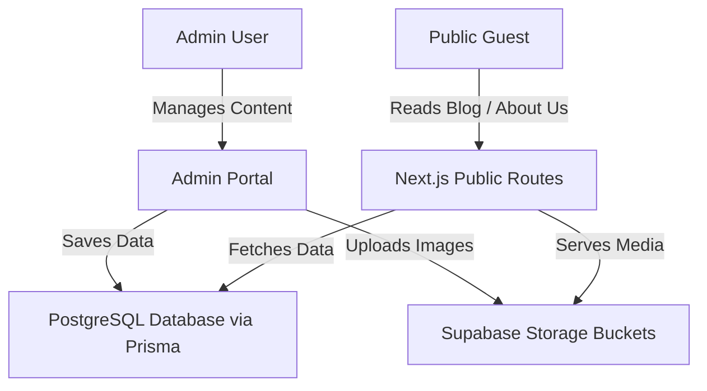

# CMS & Blog Engine Architecture Blueprint

This document defines the technical design and data models for upgrading our Next.js application with a dynamic Marketing CMS and an SEO-optimized Blog Engine (Phase 5).

---

## 1. Architectural Overview

The CMS and Blog Engine will be integrated into the existing codebase using Next.js App Router, Prisma ORM, PostgreSQL, and Supabase Storage. The admin will manage content through a secure Admin Portal, and the public site will serve localized content with static/dynamic rendering.



---

## 2. Database Schema Extensions (Prisma)

To support testimonials, team trust-building, and search-optimized blog posts, we will update `prisma/schema.prisma` with the following additions.

### 2.1. Testimonial Model Update
Extend the existing `Testimonial` model to include a profile image field (`avatarUrl`).

```prisma
model Testimonial {
  id            String   @id @default(uuid())
  authorName    String
  authorCountry String?
  rating        Int      @default(5)
  bodyEn        String
  bodyJa        String?
  avatarUrl     String?  // [NEW] URL to the uploaded author profile image
  isPublished   Boolean  @default(false)
  sortOrder     Int      @default(0)
  createdAt     DateTime @default(now())
  updatedAt     DateTime @updatedAt
}
```

### 2.2. New TeamMember Model
Create a new `TeamMember` model to display certified adventure guides and base staff on the public 'About Us' page.

```prisma
model TeamMember {
  id          String   @id @default(uuid())
  name        String
  roleEn      String   // Localized role description (English)
  roleJa      String   // Localized role description (Japanese)
  bioEn       String?  // Optional biography (English)
  bioJa       String?  // Optional biography (Japanese)
  photoUrl    String   // URL to the uploaded team member photo
  isPublished Boolean  @default(true)
  sortOrder   Int      @default(0)
  createdAt   DateTime @default(now())
  updatedAt   DateTime @updatedAt
}
```

### 2.3. New BlogPost Model
Create a search-optimized, fully localized `BlogPost` model to drive organic traffic.

```prisma
model BlogPost {
  id            String    @id @default(uuid())
  slug          String    @unique
  titleEn       String
  titleJa       String
  contentEn     String    // Full markdown content (English)
  contentJa     String    // Full markdown content (Japanese)
  excerptEn     String?   // Short summary for index page (English)
  excerptJa     String?   // Short summary for index page (Japanese)
  coverImageUrl String?   // URL to the main blog post image
  isPublished   Boolean   @default(false)
  publishedAt   DateTime? // Timestamp for publication schedule
  metaTitleEn   String?   // Explicit SEO Meta Title (English)
  metaTitleJa   String?   // Explicit SEO Meta Title (Japanese)
  metaDescEn    String?   // Explicit SEO Meta Description (English)
  metaDescJa    String?   // Explicit SEO Meta Description (Japanese)
  createdAt     DateTime  @default(now())
  updatedAt     DateTime  @updatedAt

  @@index([slug])
}
```

---

## 3. Supabase Storage Configuration

All CMS media (blog cover images, team profile photos, testimonial avatars) will be stored in a dedicated Supabase Storage bucket.

### 3.1. Bucket Requirements
* **Bucket Name**: `cms-media`
* **Access Level**: Public (all images must be accessible by guests' web browsers without authentication).
* **Allowed MIME Types**: `image/jpeg`, `image/png`, `image/webp`
* **Maximum File Size**: `2MB`

### 3.2. Public Storage Policies (SQL)
To allow public reads but restrict writes/updates to authorized admin sessions, we will apply the following Row Level Security (RLS) policies to the bucket:

```sql
-- Allow public read access to all files in the bucket
CREATE POLICY "Allow public read access"
ON storage.objects FOR SELECT
USING (bucket_id = 'cms-media');

-- Allow authenticated admin users to upload/insert files
CREATE POLICY "Allow admin upload access"
ON storage.objects FOR INSERT
TO authenticated
WITH CHECK (bucket_id = 'cms-media');

-- Allow authenticated admin users to update/delete files
CREATE POLICY "Allow admin modify access"
ON storage.objects FOR UPDATE
TO authenticated
USING (bucket_id = 'cms-media');

CREATE POLICY "Allow admin delete access"
ON storage.objects FOR DELETE
TO authenticated
USING (bucket_id = 'cms-media');
```

---

## 4. Frontend Routes & SEO Implementation

### 4.1. Public Routes
* `/en/blog` and `/ja/blog`: Index page listing all published posts with search categories, excerpts, and covers.
* `/en/blog/[slug]` and `/ja/blog/[slug]`: Individual article viewer page. Uses dynamic routes with Next.js dynamic metadata `generateMetadata()` to inject the localized `metaTitle` and `metaDesc`.
* `/en/about` and `/ja/about`: Unified 'About Us' page displaying the team members dynamically fetched from the database, grouped by `sortOrder`.

### 4.2. Admin Content Editor
* `/admin/blog`: Article listing dashboard with edit, preview, delete, publish toggle, and create new posts.
* `/admin/blog/new` & `/admin/blog/[id]`: Fully featured Rich Text or Markdown Editor (e.g. using TipTap or SimpleMDE) with image upload drag-and-drop integrated with the Supabase storage SDK.
* `/admin/team`: CRUD management of team members, photo uploads, and display ordering.
